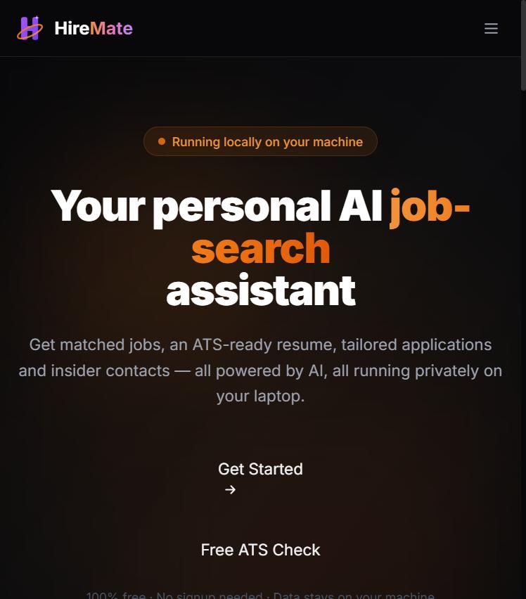
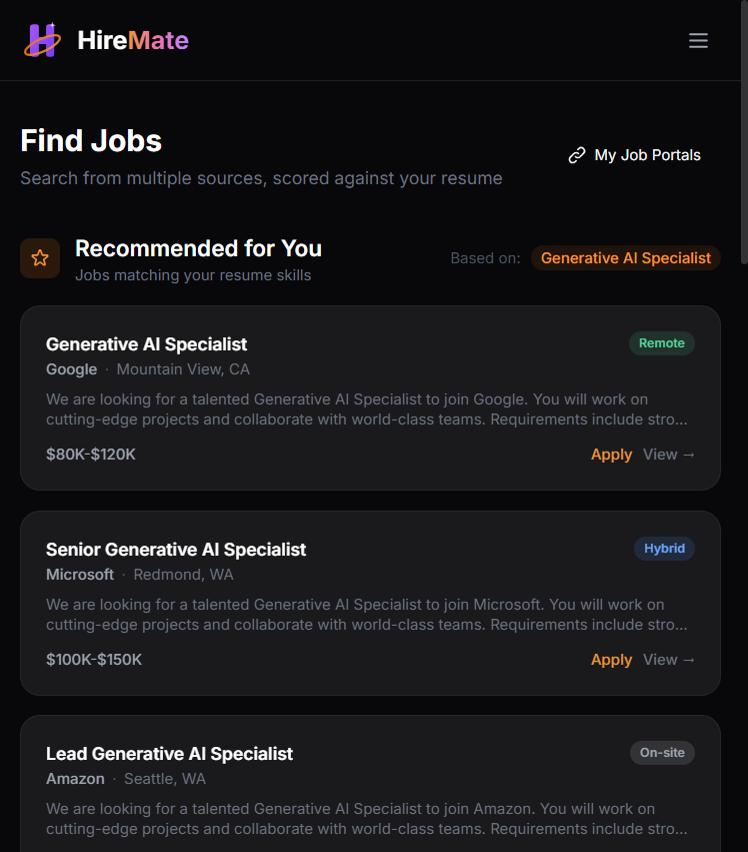
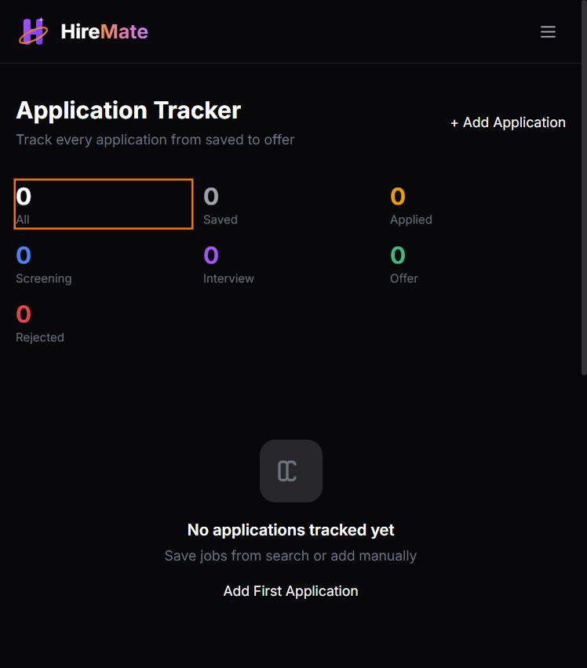

<h1 align="center">💼 HireMate</h1>
<p align="center">
  <strong>Your AI-Powered Job Search Command Center</strong><br/>
  Manage resumes, check ATS compatibility, discover jobs, generate cover letters, and track applications — all running locally on your machine.
</p>

<p align="center">
  
  
  
  
  
</p>

---

## Screenshots

<p align="center">
  
</p>
<p align="center"><em>Landing Page</em></p>

<p align="center">
  
</p>
<p align="center"><em>AI-Powered Job Discovery</em></p>

<p align="center">
  
</p>
<p align="center"><em>Application Tracker Pipeline</em></p>

---

## What is HireMate?

**HireMate** is a local-first, full-stack job search assistant that brings together everything you need for your job hunt in one dashboard. It runs as a Flask web app on your machine, keeping all your data private and under your control.

Plug in your preferred AI provider — **Ollama** (fully local), **OpenAI-compatible APIs** (LM Studio, etc.), or **Claude** — and HireMate handles everything from parsing your resume to generating tailored cover letters.

---

## Features

### 📄 Resume Manager
Upload and manage multiple resumes (PDF, DOCX, TXT). HireMate automatically parses sections — experience, skills, education — and lets you set a primary resume for matching.

### ✅ ATS Compatibility Checker
Get an AI-driven ATS (Applicant Tracking System) compatibility score with detailed feedback:
- **Strengths** — what's working well
- **Issues** — formatting or content problems
- **Recommendations** — specific improvements to make

Falls back to smart heuristics when no AI provider is configured.

### 🔍 Job Discovery
Aggregates job listings from multiple sources:
- **Remotive** — remote jobs
- **GitHub Jobs** — developer positions
- **FindWork** — tech roles

Plus direct links to 8 major job portals: LinkedIn, Indeed, Naukri, Glassdoor, Wellfound, Remotive, WeWorkRemotely, and Internshala.

### 🎯 Job–Resume Matching
Paste any job description and get an AI-powered match score showing how well your resume aligns with the requirements, along with gap analysis.

### ✂️ Resume Tailoring
AI rewrites and optimizes your resume to target a specific role or company, highlighting relevant experience and using the right keywords.

### ✉️ Cover Letter Generator
Generate personalized cover letters from your resume + job description. Ready to customize and send.

### 📊 Application Tracker
Kanban-style pipeline to track every application through stages:

```
Saved → Applied → Screening → Interview → Offer
```

Includes weekly stats, funnel analytics, and status history.

### 🔎 HR Contact Finder
AI suggests LinkedIn search queries, email patterns, and outreach templates to help you connect with hiring managers at target companies.

### 👤 Role Profiles
Create multiple role-specific profiles with targeted skills, keywords, and summaries. Switch between "Frontend Developer" and "Full-Stack Engineer" identities instantly.

### ⚡ One-Click Apply Workflow
The full pipeline in one flow:
1. Extract job details
2. Match against your resume
3. Tailor your resume
4. Generate a cover letter
5. Add to application tracker

### 📱 PWA Support
Install HireMate to your desktop like a native app — includes service worker and manifest for offline-capable progressive web app experience.

---

## Tech Stack

| Component | Technology |
|-----------|-----------|
| **Backend** | Python 3.12, Flask |
| **Database** | SQLite (WAL mode) |
| **Frontend** | Jinja2 Templates, Tailwind CSS, Vanilla JS |
| **Resume Parsing** | PyPDF2, python-docx |
| **Web Scraping** | BeautifulSoup4, Requests |
| **AI Providers** | Ollama (local), OpenAI-compatible, Claude API |
| **PWA** | Service Worker, Web App Manifest |

---

## AI Provider Support

HireMate works with multiple AI backends — choose what fits your setup:

| Provider | Privacy | Setup |
|----------|---------|-------|
| **Ollama** | Fully local — nothing leaves your machine | Install Ollama, pull a model |
| **OpenAI-compatible** | Depends on endpoint (LM Studio = local) | Set API endpoint in settings |
| **Claude API** | Cloud-based | Add API key in settings |
| **No AI** | Full privacy | ATS checker uses heuristics; AI features disabled |

---

## Project Structure

```
HireMate/
├── app.py                 # Flask routes & main application (19K)
├── database.py            # SQLite ORM with 8 model classes (21K)
├── ai_engine.py           # 6 AI-powered functions (8K)
├── ai_provider.py         # Multi-provider AI abstraction (6K)
├── resume_parser.py       # PDF/DOCX/TXT resume parsing (4K)
├── job_search.py          # Job aggregation from multiple APIs (6K)
├── config.py              # App configuration
├── launcher.py            # App launcher
├── templates/             # 11 Jinja2 HTML templates
│   ├── base.html
│   ├── dashboard.html
│   ├── resume.html
│   ├── ats_check.html
│   ├── jobs.html
│   ├── tracker.html
│   ├── cover_letter.html
│   ├── hr_finder.html
│   └── ...
├── static/
│   ├── css/               # Tailwind styles
│   ├── js/                # Client-side JS
│   ├── favicon.svg
│   ├── sw.js              # Service worker
│   └── manifest.json      # PWA manifest
├── data/
│   └── hiremate.db        # SQLite database
├── HireMate.bat           # Windows launcher
└── HireMate.vbs           # Silent Windows launcher
```

---

## Getting Started

### Prerequisites
- Python 3.12+
- pip

### Installation

1. **Clone the repo**
   ```bash
   git clone https://github.com/codent01/HireMate.git
   cd HireMate
   ```

2. **Install dependencies**
   ```bash
   pip install flask PyPDF2 python-docx beautifulsoup4 requests
   ```

3. **Run the app**
   ```bash
   python app.py
   ```
   Or on Windows, double-click `HireMate.bat`

4. **Open in browser**
   ```
   http://localhost:5000
   ```

### Configure AI (Optional)

Navigate to Settings in the app and configure your preferred AI provider:

- **Ollama:** Install [Ollama](https://ollama.ai), pull a model (`ollama pull llama3`), and set the endpoint
- **LM Studio:** Start the local server and point HireMate to it
- **Claude:** Add your API key

HireMate works without AI too — ATS checking falls back to heuristics, and you can still use resume management, job search, and application tracking.

---

## Database Schema

HireMate uses 8 SQLite tables:

| Table | Purpose |
|-------|---------|
| `users` | User profiles and settings |
| `resumes` | Uploaded resumes with parsed sections |
| `jobs` | Discovered and saved job listings |
| `applications` | Application tracking with status pipeline |
| `cover_letters` | Generated cover letters |
| `role_profiles` | Role-specific keyword profiles |
| `ai_settings` | AI provider configuration |
| `activity_log` | User activity history |

---

## Roadmap

- [x] Resume upload and parsing
- [x] ATS compatibility checker
- [x] Multi-source job aggregation
- [x] AI-powered resume tailoring
- [x] Cover letter generation
- [x] Kanban application tracker
- [x] HR contact finder
- [x] PWA support
- [ ] Email integration for application follow-ups
- [ ] Interview preparation assistant
- [ ] Salary negotiation helper
- [ ] Chrome extension for one-click job capture

---

## Privacy

HireMate is built with a **local-first** philosophy:
- All data stored in a local SQLite database on your machine
- No mandatory cloud services — works fully offline with Ollama
- No analytics, tracking, or telemetry
- Your resumes and job data never leave your machine (unless you choose a cloud AI provider)

---

<p align="center">
  <i>Built to make the job search less painful and more productive.</i><br/>
  <strong>Your data. Your machine. Your career.</strong>
</p>
